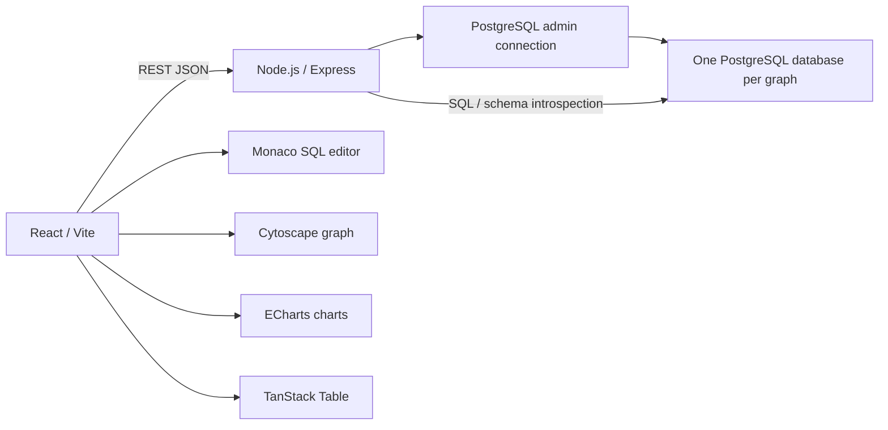

# Architecture

## Frontend

HTML and CSS provide the paper-like layout, folded SVG T-rex branding, responsive four-column database gallery and collapsible workspace sidebar. `src/Landing.jsx` and `src/landing.css` provide the full-width forest landing page, original vector dinosaur artwork, and dedicated graph-creation workspace. The landing page hides workspace navigation; the footer has been removed. React controls navigation, connection state, SQL drafts, results, and loaded snapshots. Vite compiles the frontend and proxies development API calls. Graphs rebuild from database snapshots; search is applied with Enter or Search and matches labels/property values case-insensitively. Only matching vertices, incident edges, and adjacent vertices remain displayed; unrelated elements are hidden. Fit graph and Show all nodes reset the filter. Selecting a vertex opens its properties. Charts group the selected column into record counts. Tables support sorting, filtering, and pagination in memory.

## Backend and storage

Express uses node-postgres pools configured through environment variables. Database creation uses a validated `gibble_` prefix and quoted identifiers. The registry is PostgreSQL's own pg_database catalog; no separate metadata store is required. Display names are normalized from database names. Each graph uses public-schema tables managed through user SQL. Parameterized metadata lookups and identifier quoting protect application-generated queries; user SQL intentionally remains executable SQL.

`server/graph.js` transforms rows and catalog foreign keys to Cytoscape JSON. Unambiguous two-foreign-key junction tables are projected as direct edges, retaining their row properties for inspection. Their SQL rows remain available in Tables and Charts. Edges use schema column order for direction; enrollments use “enrolled in” and teaching_assignments use “teaches.” Named entities and tables referenced by other tables remain vertices. Composite foreign keys use ordered column pairs and match referenced row values. Namespaced JSON vertex identifiers avoid collisions across tables and composite keys. Snapshot requests load up to 500 rows per table and return schema columns, primary keys, row counts, vertices, and edges. Snapshot reads are sequential and are not a point-in-time transaction; concurrent external writes can affect consistency.

## REST API

| Method | Path                        | Result                                                |
| ------ | --------------------------- | ----------------------------------------------------- |
| GET    | /api/health                 | Database connectivity                                 |
| GET    | /api/databases              | Managed database names and byte sizes                 |
| POST   | /api/databases              | Create database from `{name}`                         |
| POST   | /api/databases/:id/query    | Execute `{sql}`; ordered command results and duration |
| GET    | /api/databases/:id/snapshot | Tables, columns, loaded rows, counts, nodes, edges    |

Errors return JSON `{error}`. Query requests use a dedicated connection and transaction, rollback on errors, and destroy the connection afterward to discard session state. Pools cap connections at four per database. The API accepts up to 1 MB JSON input. SQL result payloads are not capped: explicit LIMIT is recommended. Database deletion, SQL history persistence, users, authentication, and cloud hosting are outside this initial implementation.

## Deployment

Docker Compose runs PostgreSQL 17 with a named persistent volume and loopback host port. Development runs Vite and Express concurrently. Production builds compile to `dist/`, which Express serves alongside REST endpoints. No HugeGraph or Hubble API is used. All real database data remains in PostgreSQL; the bundled sample is immutable frontend data. This implementation targets a trusted local user and must be hardened before any shared deployment.
